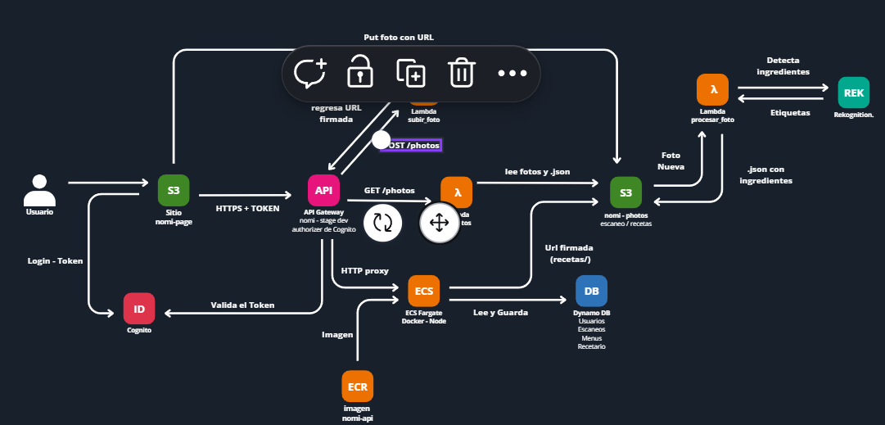

# Nomi

Aplicación web que arma tu menú de la semana a partir de una foto de tu refri: detecta los ingredientes que tienes, genera 7 días de desayuno, comida y cena con lo que ya hay en tu refri y te dice las calorías de cada comida.

Proyecto final de **Desarrollo en la Nube** (ITESO).

**Página:** https://nomi-page-2026.s3.us-east-1.amazonaws.com/index.html

## Integrantes
| Integrante | Expediente | Parte principal |
|---|---|---|
| Alan Alejandro Rodríguez Avalos | 753343 | Fotos del refri: Lambdas + Rekognition |
| Enrique Alonso Ruvalcaba Martinez | 751600 | Página, backend en ECS, API Gateway, Cognito, DynamoDB y S3 |

## Arquitectura


| Servicio | Para qué se usa |
|---|---|
| **S3 `nomi-page-2026`** | Sitio estático: HTML, CSS y JS |
| **Cognito** | Crear cuenta, confirmar con código e iniciar sesión (User Pool, app client `nomi-web`) |
| **API Gateway `nomi`** | Única entrada a la API (stage `dev`); revisa el token con un authorizer de Cognito, manda `/photos` a las Lambdas y lo demás a ECS con `/{proxy+}` |
| **ECS Fargate + ECR** | Backend en Node/Express en un contenedor Docker; la imagen vive en ECR |
| **DynamoDB** | Tablas `usuarios`, `escaneos`, `menus` y `recetario` |
| **S3 `nomi-photos`** | Bucket privado con dos carpetas: `recetas/` (fotos de las recetas) y `escaneos/` (fotos del refri y sus ingredientes) |
| **Lambda `subir_foto`** (Python) | `POST /photos`: da una URL firmada para que la página suba la foto a S3 |
| **Lambda `ver_fotos`** (Python) | `GET /photos`: historial de fotos con los ingredientes detectados |
| **Lambda `procesar_foto`** (Python) + **Rekognition** | Se activa al llegar una foto a `escaneos/`; detecta los ingredientes y los guarda en un `.json` junto a la foto |

## Documentación
| Archivo | Contenido |
|---|---|
| `docs/solucion.png` | Diagrama de la solución |
| `docs/api.md` | API Gateway, sesión con Cognito, endpoints y validaciones |
| `docs/modelo-datos.md` | Tablas, llaves, consultas principales y por qué DynamoDB |
| `docs/backend.md` | Cómo está hecho el backend |
| `docs/frontend.md` | Páginas y qué hace cada JS |
| `docs/despliegue.md` | Paso a paso para levantar todo en el Learner Lab |
| `docs/pendientes.md` | Lo que falta y riesgos |
| `docs/evidencias/` | Capturas de la consola de AWS |

## Estructura
```
nomi/
├── docs/
└── src/
    ├── backend/                 # API de Nomi (Node + Express)
    │   ├── main.js              # Arranca el servidor y junta las rutas
    │   ├── routes/              # URL → controller
    │   ├── middlewares/         # sesion.js: usuario del token de Cognito
    │   ├── controllers/         # Valida y responde
    │   ├── data/                # DynamoDB y S3
    │   ├── utils/menu.js        # Fechas y armado del menú
    │   └── Dockerfile
    ├── frontend/                # Página (se sube a S3)
    │   ├── *.html
    │   ├── css/
    │   └── js/                  # config.js, api.js, tema.js, semana.js y un JS por página
    ├── lambdas/                 # Lambdas de fotos (Python)
    │   ├── subir_foto/          # POST /photos → URL firmada
    │   ├── ver_fotos/           # GET /photos → historial
    │   └── procesar_foto/       # Trigger de S3 → Rekognition
    └── scripts/
        ├── crear_tablas.py      # Crea las tablas de DynamoDB
        └── cargar_datos.py      # Carga las recetas y datos de prueba
```

## Correrlo en tu compu
1. Copia las credenciales del Learner Lab (**AWS Details → AWS CLI**) a `~/.aws/credentials`.
2. Crea `src/backend/.env`:
   ```
   PORT=3000
   AWS_REGION=us-east-1
   TZ=America/Mexico_City
   BUCKET_IMAGENES=nomi-photos
   ```
3. Arranca el backend:
   ```
   cd src/backend
   npm install
   node main.js
   ```
4. En `src/frontend/js/config.js` cambia `API_URL` a `http://localhost:3000` y abre `src/frontend/index.html`. El login sigue siendo con Cognito.

## Subirlo a la nube
Detalle en `docs/despliegue.md`:
1. DynamoDB: `crear_tablas.py` y `cargar_datos.py`.
2. Fotos de recetas en `s3://nomi-photos/recetas/`.
3. Imagen del backend a ECR y servicio en ECS.
4. Cognito y API Gateway con su authorizer.
5. Lambdas de fotos y trigger de S3.
6. Página: `aws s3 sync src/frontend s3://nomi-page-2026 --delete`.
