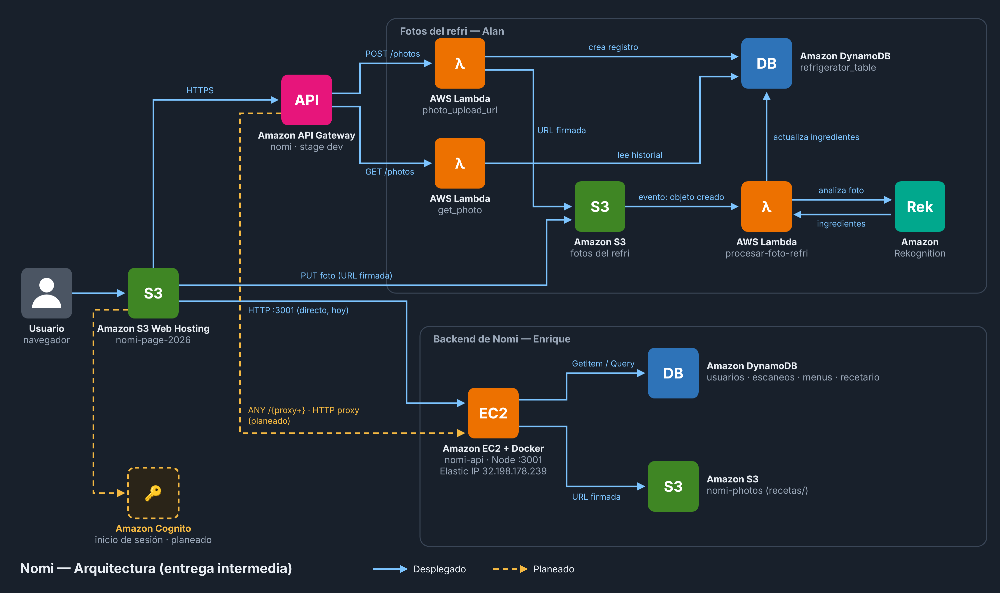
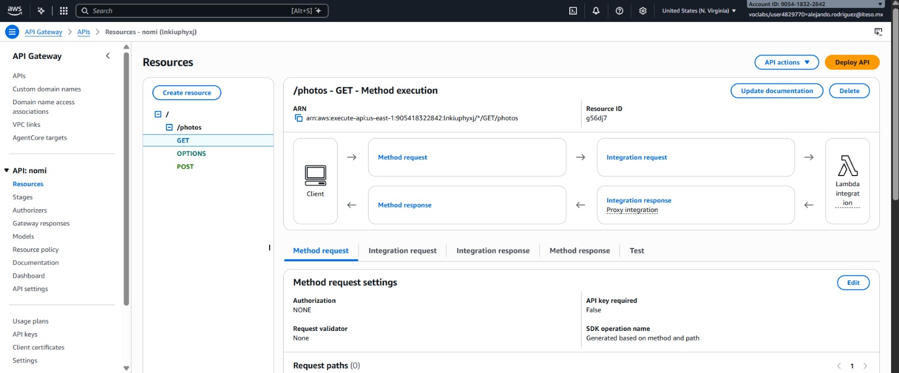

# API

## Flujo de una petición


```
Página (S3 nomi-page-2026) ─→ API Gateway "nomi" (stage dev)
                                 ├─ /photos     ─Lambda proxy→ photo_upload_url / get_photo ─→ S3 ─→ Rekognition
                                 └─ /{proxy+}   ─HTTP proxy→  EC2 nomi-api: contenedor Docker Node :3001 ─→ DynamoDB / S3 nomi-photos (planeado)
```
Hoy la página llama directo a la EC2 (`http://32.198.178.239:3001`); cuando exista `/{proxy+}` todo pasa por el mismo API Gateway.

## API Gateway
Un solo API para todo el proyecto.

| API | Tipo | Stage | Invoke URL |
|---|---|---|---|
| `nomi` (`lnkiuphyxj`) | REST | `dev` | `https://lnkiuphyxj.execute-api.us-east-1.amazonaws.com/dev` |

### Recursos


| Recurso | Método | Integración | Destino | Request | Response | Estado |
|---|---|---|---|---|---|---|
| `/photos` | `POST` | Lambda proxy | `photo_upload_url` | `{ "fileType": "image/jpeg", "userId": "u1" }` | `200 { "url", "clave" }` | ✅ Desplegado |
| `/photos` | `GET` | Lambda proxy | `get_photo` | `?userId=u1` | `200 { "fotos": [...] }` | ✅ Desplegado |
| `/photos` | `OPTIONS` | Mock | CORS | — | Headers CORS | ✅ Desplegado |
| `/{proxy+}` | `ANY` | HTTP proxy | `http://32.198.178.239:3001/{proxy}` | Igual que la API de Nomi | Igual que la API de Nomi | ⏳ Planeado |

`/photos` es más específico que `/{proxy+}`, así que las fotos van a la Lambda y el resto (`/usuarios`, `/escaneos`, `/menus`, `/recetas`) a la EC2.

Así queda `config.js` con un solo API:
```js
API_URL: "https://lnkiuphyxj.execute-api.us-east-1.amazonaws.com/dev",
API_REFRI_URL: "https://lnkiuphyxj.execute-api.us-east-1.amazonaws.com/dev/photos"
```

### ¿Por qué un solo API Gateway?
Una sola URL y un solo stage para la página, un solo lugar para CORS y un diagrama más simple.

### ¿Proxy o no proxy?
Usamos **proxy** en los dos casos:
- **EC2 (HTTP proxy):** Express ya valida, arma las respuestas y pone los códigos (400, 404, 409). Un solo recurso `/{proxy+}` manda todas las rutas al contenedor sin repetir cada endpoint en API Gateway ni escribir mapping templates.
- **Lambda (Lambda proxy):** la Lambda recibe el evento completo (método, query, body) y regresa `statusCode`, headers y body, así decide la respuesta ella misma.

Lo que se pierde: API Gateway no valida el body (lo hace el backend) y no se documentan los recursos uno por uno en la consola.

## API de Nomi (backend en EC2)
Base actual: `http://32.198.178.239:3001`. Código en `src/backend`. Todas las respuestas son JSON.

| Código | Significado |
|---|---|
| 200 / 201 | OK / creado |
| 400 | Faltan datos o son inválidos → `{ "error": "mensaje" }` |
| 404 | No existe |
| 409 | Ya existe |

| Método | Ruta | Qué hace | Tabla |
|---|---|---|---|
| `GET` | `/` | Revisa que la API viva → `{ "ok": true }` | — |
| `GET` | `/usuarios/{usuario_id}` | Perfil | `usuarios` |
| `POST` | `/usuarios` | Crea usuario (400 si faltan `usuario_id`, `nombre`, `correo`, `personas`; 409 si existe) | `usuarios` |
| `PUT` | `/usuarios/{usuario_id}` | Cambia solo los campos enviados; `null` borra el campo | `usuarios` |
| `POST` | `/escaneos` | Guarda el escaneo y genera el menú de la semana | `escaneos`, `recetario`, `menus` |
| `GET` | `/escaneos/{usuario_id}/ultimo` | Último escaneo con `foto_url` firmada | `escaneos` |
| `GET` | `/menus/{usuario_id}/{semana}` | Menú de la semana (`2026-W45`) | `menus` |
| `PUT` | `/menus/{usuario_id}/{semana}` | Reemplaza el menú (400 si no son 7 días) | `menus` |
| `GET` | `/recetas?categoria=desayuno` | Recetas (con categoría usa el GSI) con `imagen_url` firmada | `recetario` |
| `GET` | `/recetas/{receta_id}` | Una receta | `recetario` |

## Caso de uso de punta a punta
1. `escanear_refri.html`: la foto sube con `POST /photos` + `PUT` a S3 → Rekognition detecta ingredientes → se ven en el historial (`GET /photos`).
2. El usuario confirma los ingredientes y da **Generar menú** → `POST /escaneos` guarda el escaneo en DynamoDB y crea el menú.
3. `menu.html` → `GET /menus/u1/2026-W45` pinta los 7 días.

## Pruebas
Cuando exista `/{proxy+}`, cambia `API` por `https://lnkiuphyxj.execute-api.us-east-1.amazonaws.com/dev`.
```bash
API=http://32.198.178.239:3001
```

**GET — perfil**
```bash
curl $API/usuarios/u1
```
```json
{"usuario_id":"u1","nombre":"Enrique Ruvalcaba","correo":"enrique@gmail.com","personas":2,"comidas_por_dia":3,"dia_escaneo":"domingo","tiempo_max_min":45,"meta_calorias":2000,"meta_proteina":120,"preferencias":["sin_cerdo"],"tema":"dark"}
```

**GET — recetas por categoría (GSI)**
```bash
curl "$API/recetas?categoria=desayuno"
```
→ `200` con 3 recetas, cada una con `imagen_url` firmada.

**POST — escaneo que genera el menú**
```bash
curl -X POST $API/escaneos -H "Content-Type: application/json" \
  -d '{"usuario_id":"u1","personas":2,"comidas_por_dia":3,"ingredientes":[{"nombre":"huevo","cantidad":"12 piezas"}]}'
```
→ `201` con el escaneo guardado, su `fecha` y `"semana":"2026-W45"`.

**GET — menú generado**
```bash
curl $API/menus/u1/2026-W45
```
→ `200 { "usuario_id":"u1", "semana":"2026-W45", "dias":[ 7 días ] }`

**Peticiones mal formadas**
```bash
curl -X POST $API/escaneos -H "Content-Type: application/json" -d '{"usuario_id":"u1"}'
# 400 {"error":"Faltan usuario_id, personas o ingredientes."}

curl $API/usuarios/nadie
# 404 {"error":"El usuario no existe."}
```

**API de fotos**
```bash
curl -X POST https://lnkiuphyxj.execute-api.us-east-1.amazonaws.com/dev/photos \
  -H "Content-Type: application/json" -d '{"fileType":"image/jpeg","userId":"u1"}'
# 200 {"url":"https://...amazonaws.com/...","clave":"..."}

curl "https://lnkiuphyxj.execute-api.us-east-1.amazonaws.com/dev/photos?userId=u1"
# 200 {"fotos":[{"url_foto":"https://...","createdAt":1793900000,"ingredientes":["Egg","Milk"]}]}
```
