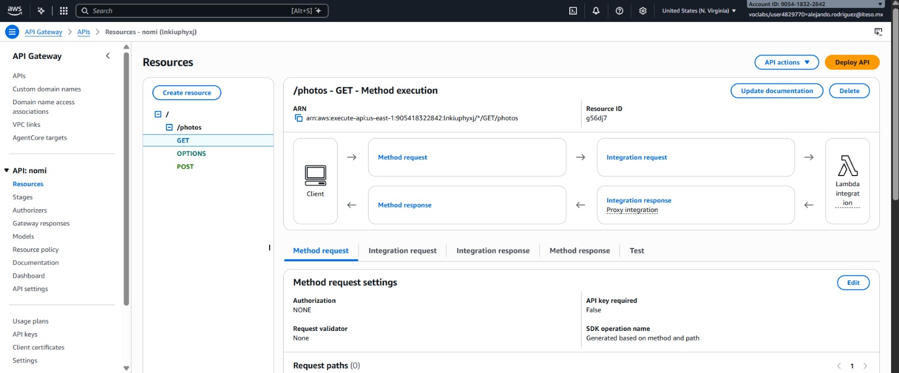
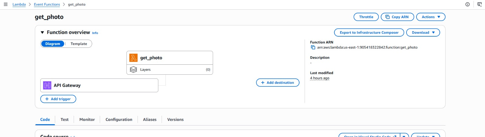
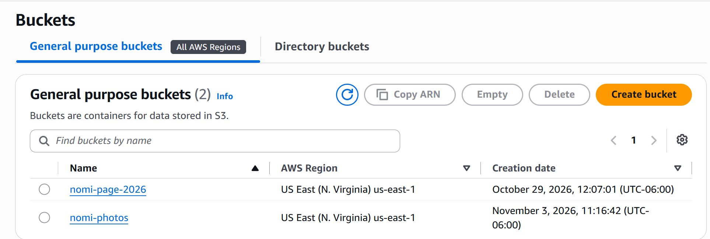
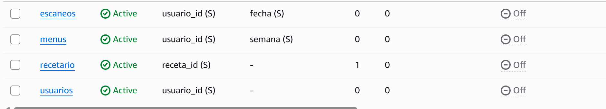
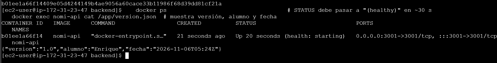
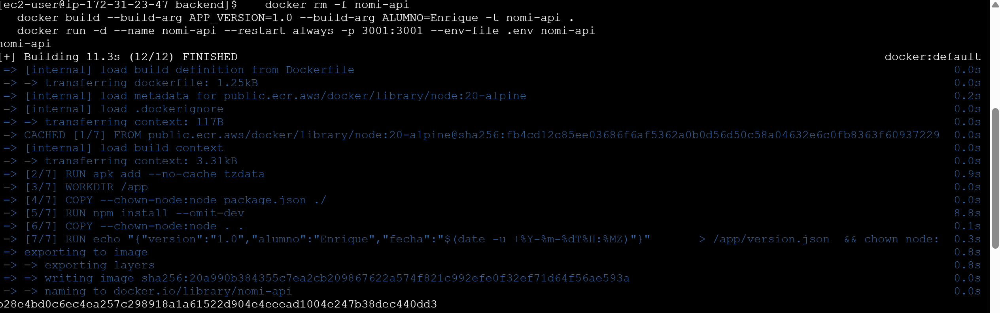
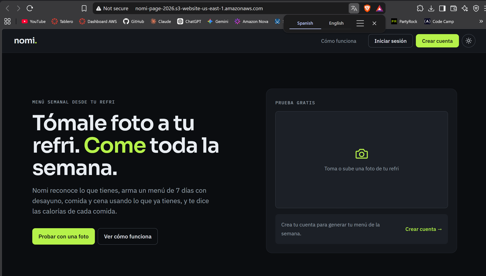
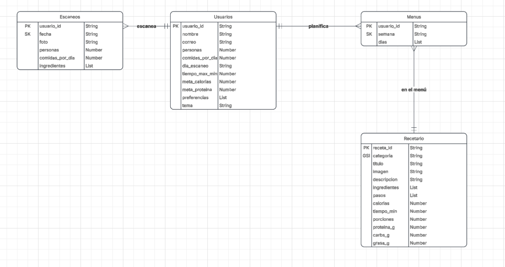

# Evidencias

**Página:** https://nomi-page-2026.s3.us-east-1.amazonaws.com/index.html
**API de Nomi (API Gateway):** https://zj991lzgv6.execute-api.us-east-1.amazonaws.com/dev
**API de fotos:** https://zj991lzgv6.execute-api.us-east-1.amazonaws.com/dev/photos (mismo API Gateway)

### Entrega intermedia: recurso `/photos` en la cuenta de Alan (ahora está en el API Gateway `nomi`)

### Entrega intermedia: Lambda `get_photo` (ahora `ver_fotos`)

### Entrega intermedia: Lambda `photo_upload_url` (ahora `subir_foto`)

### Buckets `nomi-page-2026` (página) y `nomi-photos` (imágenes)

### Tablas `usuarios`, `escaneos`, `menus` y `recetario` activas, con sus llaves y el GSI de `recetario`

### EC2 `nomi-api` (entrega intermedia; ahora el backend corre en ECS)

### `docker ps` con el contenedor `nomi-api` en el puerto 3001 y `version.json` (versión 1.0, alumno, fecha)

### `docker build` con `--build-arg` y `docker run --restart always --env-file .env`

### Página funcionando desde el sitio estático de S3

### Diagrama entidad-relación de las 4 tablas

## Faltan
- ECS: servicio `nomi-api` corriendo y la imagen en ECR.
- Cognito: User Pool y app client `nomi-web`.
- API Gateway `nomi`: `/{proxy+}` y `/photos` con el authorizer.
- Lambdas `subir_foto`, `ver_fotos` y `procesar_foto` (con su trigger de S3).
- Carpeta `escaneos/` en `nomi-photos` con una foto y su `.json`.
- Tabla con datos (**Explore items**).
