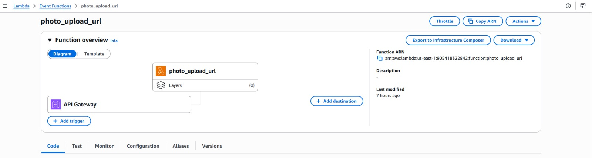
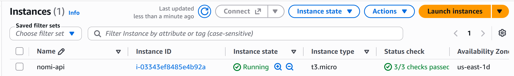

# Evidencias

**Página:** http://nomi-page-2026.s3-website-us-east-1.amazonaws.com
**API de Nomi (EC2):** http://32.198.178.239:3001
**API de fotos (API Gateway, stage `dev`):** https://lnkiuphyxj.execute-api.us-east-1.amazonaws.com/dev/photos

### API Gateway `nomi`: recurso `/photos` con `GET`, `POST` y `OPTIONS`, integración Lambda proxy

### Lambda `get_photo` con su trigger de API Gateway (`GET /photos`)

### Lambda `photo_upload_url` con su trigger de API Gateway (`POST /photos`)

### Buckets `nomi-page-2026` (página) y `nomi-photos` (imágenes)

### Tablas `usuarios`, `escaneos`, `menus` y `recetario` activas, con sus llaves y el GSI de `recetario`

### EC2 `nomi-api` (t3.micro) corriendo con 3/3 checks

### `docker ps` con el contenedor `nomi-api` en el puerto 3001 y `version.json` (versión 1.0, alumno, fecha)

### `docker build` con `--build-arg` y `docker run --restart always --env-file .env`

### Página funcionando desde el sitio estático de S3

### Diagrama entidad-relación de las 4 tablas

