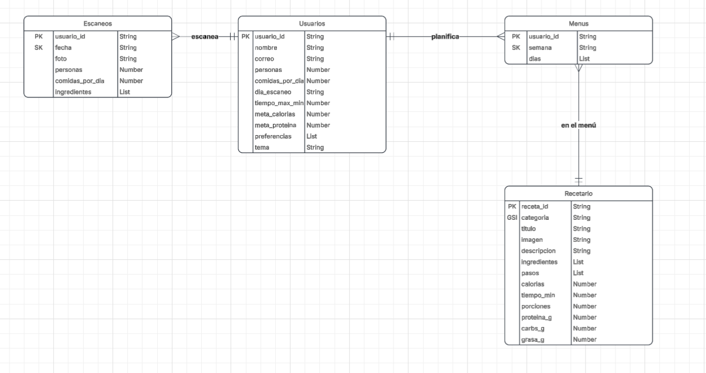
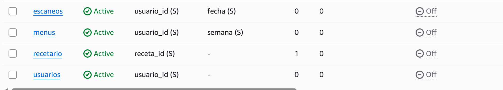

# Modelo de datos

Nomi usa 4 tablas de DynamoDB (`PAY_PER_REQUEST`) y un bucket privado de S3 para las imágenes.



En DynamoDB solo se declaran las llaves (PK, SK y las del GSI); los demás atributos van en cada item. Las relaciones son lógicas: no hay llaves foráneas y el backend valida que el usuario exista.

```
Usuarios 1 ──── N Escaneos      (escanea)
Usuarios 1 ──── N Menus         (planifica)
Menus    N ──── N Recetario     (en el menú, por receta_id dentro de dias)
```

## ¿Por qué DynamoDB y no RDS?
- Todas las consultas de la app son **por usuario** (su perfil, su último escaneo, su menú de una semana): encajan directo en una PK `usuario_id` con SK, sin JOINs.
- El menú es un documento anidado (7 días × 3 comidas). En DynamoDB se guarda como un solo item; en SQL serían 3 tablas y JOINs.
- Sin servidor que administrar, cobro por petición y sin costo con la app sin uso. Se maneja con permisos IAM (`LabInstanceProfile`), sin usuario y contraseña de base de datos.
- Lo que se pierde: no hay JOINs ni consultas libres. Por eso el menú copia título y kcal de la receta (desnormalización) y `recetario` tiene un GSI por categoría.

## Consultas principales
| # | Qué necesita la app | Operación en DynamoDB | Endpoint |
|---|---|---|---|
| 1 | Perfil del usuario | `GetItem` en `usuarios` por `usuario_id` | `GET /usuarios/{usuario_id}` |
| 2 | Último escaneo del refri | `Query` en `escaneos` con `usuario_id = :u`, `ScanIndexForward=false`, `Limit=1` | `GET /escaneos/{usuario_id}/ultimo` |
| 3 | Menú de una semana | `GetItem` en `menus` por `usuario_id` + `semana` (ej. `2026-W45`) | `GET /menus/{usuario_id}/{semana}` |
| 4 | Recetas de una categoría | `Query` en el GSI `CategoriaIndex` con `categoria = :c` | `GET /recetas?categoria=desayuno` |

Ninguna consulta usa `Scan` salvo `GET /recetas` sin categoría (son 9 recetas).

## Tablas

### `usuarios` — PK `usuario_id`
| Atributo | Tipo | Descripción |
|---|---|---|
| `usuario_id` | String | **PK** |
| `nombre`, `correo` | String | Datos del usuario |
| `personas` | Number | Para cuántas personas cocina |
| `comidas_por_dia` | Number | 1 a 3 (desayuno, comida, cena) |
| `dia_escaneo` | String | Día en que escanea su refri |
| `tiempo_max_min` | Number | Minutos máximos por comida |
| `meta_calorias`, `meta_proteina` | Number | Metas diarias (opcionales) |
| `preferencias` | List | Ej. `["vegetariano", "sin_cerdo"]` |
| `tema` | String | `auto`, `dark` o `light` |

La contraseña no se guarda aquí; la manejará Cognito (planeado).

### `escaneos` — PK `usuario_id`, SK `fecha`
| Atributo | Tipo | Descripción |
|---|---|---|
| `usuario_id` | String | **PK** |
| `fecha` | String | **SK**, fecha y hora ISO (`2026-11-01T18:30:00`); ordena los escaneos |
| `foto` | String | Llave de la foto en S3 |
| `personas`, `comidas_por_dia` | Number | Con lo que se armó el menú |
| `ingredientes` | List | `[{ "nombre": "huevo", "cantidad": "12 piezas" }]` |

La SK con fecha ISO hace que la consulta 2 sea un `Query` ordenado en vez de leer todos los escaneos.

### `menus` — PK `usuario_id`, SK `semana`
| Atributo | Tipo | Descripción |
|---|---|---|
| `usuario_id` | String | **PK** |
| `semana` | String | **SK**, semana ISO (`2026-W45`) |
| `dias` | List | Los 7 días |

```json
{ "dia": "lunes", "fecha": "2026-11-02", "total_kcal": 1430,
  "comidas": {
    "desayuno": { "receta_id": "r1", "titulo": "Huevos a la mexicana", "calorias": 320,
                  "tiempo_min": 15, "proteina_g": 20, "carbs_g": 10, "grasa_g": 22, "usa_refri": true },
    "comida": { }, "cena": { } } }
```
Título, kcal y macros se copian de `recetario` para pintar la semana con 1 lectura en lugar de 21.

### `recetario` — PK `receta_id`, GSI `CategoriaIndex` (PK `categoria`)
| Atributo | Tipo | Descripción |
|---|---|---|
| `receta_id` | String | **PK** |
| `categoria` | String | **PK del GSI**: `desayuno`, `comida` o `cena` |
| `titulo`, `descripcion` | String | |
| `imagen` | String | Llave en S3 (`recetas/r1.jpg`) |
| `ingredientes`, `pasos` | List | |
| `calorias`, `tiempo_min`, `porciones` | Number | |
| `proteina_g`, `carbs_g`, `grasa_g` | Number | Macros por porción |

## S3 `nomi-photos` (privado)
| Prefijo | Contenido |
|---|---|
| `recetas/{receta_id}.jpg` | Foto de cada receta |
| `escaneos/{usuario_id}/{fecha}.jpg` | Foto del refri |

El backend convierte la llave en una URL firmada (1 h) antes de mandarla a la página.

## Datos de prueba


`src/scripts/crear_tablas.py` crea las tablas y `src/scripts/cargar_datos.py` carga 2 usuarios (`u1`, `u2`), un escaneo por usuario, 9 recetas (3 por categoría) y el menú `2026-W45` de cada usuario.

## Fotos del refri (API de Alan)
La foto del refri no pasa por la EC2: la página la sube directo a S3 con una URL firmada que da la Lambda `photo_upload_url`, Rekognition detecta los ingredientes y `get_photo` regresa el historial. Su tabla está en la rama `alan`.
